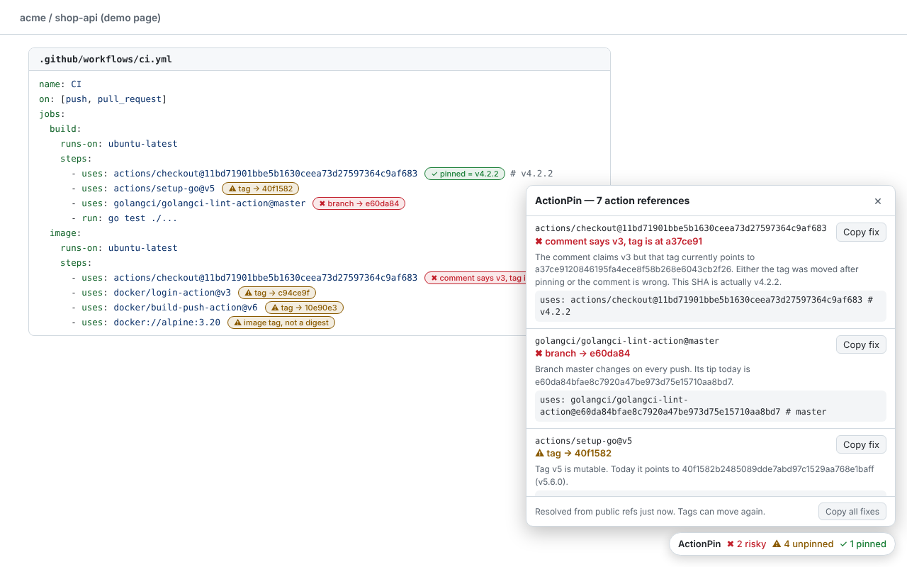

# ActionPin

> Chrome extension. A SHA-pin lens for GitHub Actions: on any GitHub page that shows workflow YAML, it labels every `uses:` line as pinned, tag or branch, resolves it to a commit SHA, and catches pins whose version comment is wrong.

**Topics:** `chrome-extension` `manifest-v3` `github-actions` `supply-chain-security` `sha-pinning` `devsecops` `ci-cd` `javascript`



## What it does

| You see | Meaning |
|---|---|
| `✓ pinned = v4.2.2` | 40-character SHA, and it is the commit behind that tag |
| `⚠ tag → 11d5960` | Mutable tag. This is the commit it points to right now |
| `✖ branch → f548e57` | Branch ref. Changes on every push |
| `✖ comment says v3, tag is at a37ce91` | The SHA is pinned, but the `# v3` comment next to it is false |
| `✖ tag and branch both named v1` | Ambiguous ref |
| `⚠ image tag, not a digest` | `docker://image:tag` without `@sha256:` |

A panel at the bottom right lists every reference with a **Copy fix** button that puts the pinned form on the clipboard:

```yaml
uses: actions/checkout@eef61447b9ff4aafe5dcd4e0bbf5d482be7e7871 # v4.2.1
```

The comment uses the most specific tag at that commit (`v4.2.1`, not `v4`), which is the form Dependabot and Renovate keep up to date.

The toolbar icon shows a badge with the number of unpinned references on the current tab. Clicking it lists them, or says why there is nothing to show: the tab is not on github.com, the page has no `uses:` lines, or the tab was open before the extension was installed and needs a reload.

## Install (unpacked)

1. Open `chrome://extensions` and turn on **Developer mode**.
2. Click **Load unpacked** and pick the `extension` folder of this repo.
3. Open any workflow file on GitHub, for example `https://github.com/actions/checkout/blob/main/.github/workflows/test.yml`.

## Repo layout

| Path | What it is |
|---|---|
| `extension/` | The extension itself. This folder is what Chrome loads and what gets zipped for the store |
| `extension/lib/core.js` | Pure logic: parse `uses:` lines, parse git ref listings, decide the verdict |
| `extension/background.js` | Service worker: fetches public refs from github.com, caches them, sets the badge |
| `extension/content.js` | Finds `uses:` lines on the page, labels them, draws the panel |
| `test/` | Unit tests (Node's built-in runner, no dependencies) |
| `e2e/` | Playwright harness: loads the extension in Chromium against a fixture page |
| `store/` | Chrome Web Store assets and `LISTING.md` with every field's text |
| `scripts/package.sh` | Builds `dist/actionpin-<version>.zip` for upload |

## How it works

```
content.js (github.com)                background.js (service worker)
  find lines matching `uses:`   ──►      GET github.com/<owner>/<repo>.git/info/refs?service=git-upload-pack
  set data-attributes + panel   ◄──      parse ref advertisement, compare, return verdict + fix
```

- Refs come from git's own smart-HTTP endpoint, the same request `git ls-remote` makes. No GitHub API, no token, no rate-limit budget to burn.
- Requests are sent with `credentials: 'omit'`, so no cookie leaves the browser. Consequence: private action repos show as "not pinned (not checked)" rather than being resolved.
- Inline labels are CSS `::after` content driven by data-attributes. No nodes are inserted into GitHub's DOM and the label text is never part of what you copy.
- Results are cached for 10 minutes in `chrome.storage.session`.

## Develop

```bash
npm test                 # unit tests: logic + Chrome Web Store manifest limits
npm install              # only needed for the next two (installs Playwright)
npx playwright install chromium
npm run e2e              # loads the extension in Chromium, resolves refs live from github.com
npm run screenshots      # regenerates the 1280x800 store screenshots
npm run package          # builds dist/actionpin-<version>.zip
```

`npm run e2e` makes live requests to github.com, so a network blip shows up as one failed check. Rerun before reading anything into it.

To release: raise `version` in `extension/manifest.json` and `package.json`, run `npm run package`, upload the zip in the Chrome Web Store developer dashboard.

## Limits

- A SHA that is not a tag or branch tip is reported as "pinned (no tag here)". Proving that such a commit belongs to the repo and not to a fork ("impostor commit") needs the GitHub API and is not done.
- Flow-style YAML (`- { uses: x@v1 }`) and multi-line scalars are not parsed.
- In a plain unhighlighted `<pre>` the reference is listed in the panel but gets no inline label.
- It reads; it does not edit files or open pull requests. For bulk rewriting use `pinact` or `ratchet` in the repo.

## Privacy

See [PRIVACY.md](PRIVACY.md). Short version: the only thing sent anywhere is an owner/repo name, to github.com, without cookies.

## Skills demonstrated

Manifest V3 service workers and content scripts · git smart-HTTP protocol parsing · supply-chain threat modelling for CI · DOM-framework-safe UI injection (shadow DOM, constructable stylesheets, CSS-generated labels) · least-privilege permission design · Playwright extension testing

## License

MIT. See [LICENSE](LICENSE).
